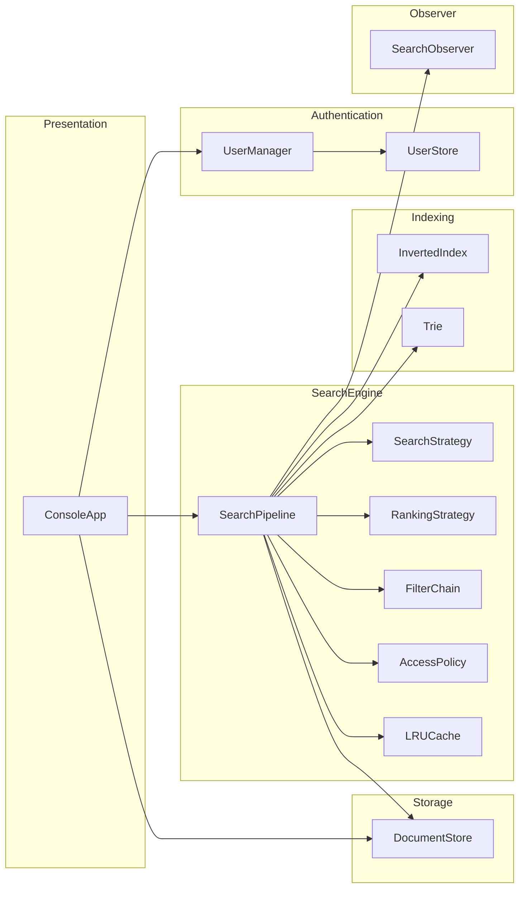
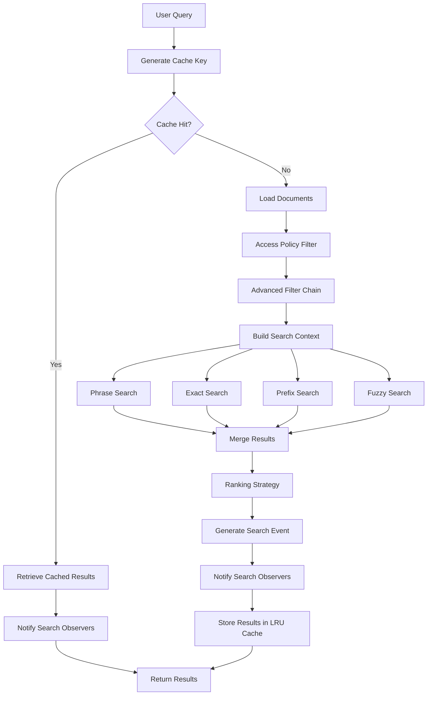
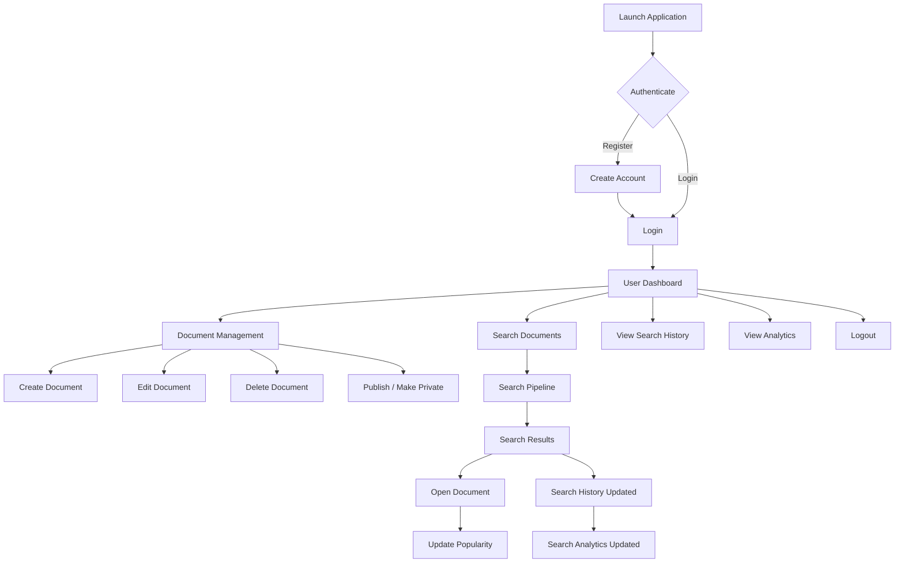
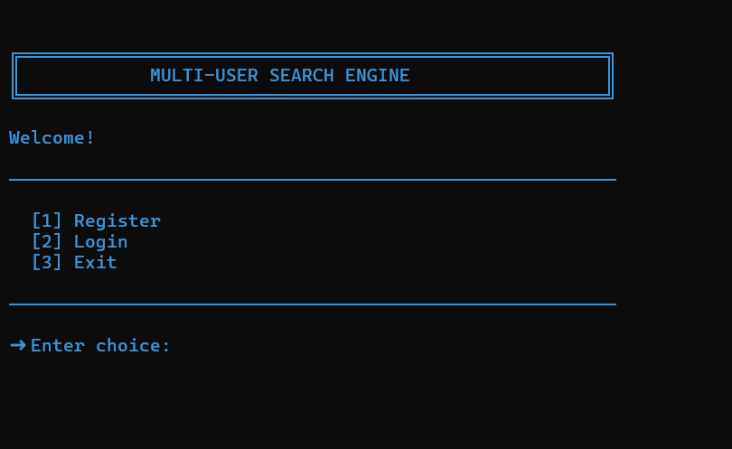
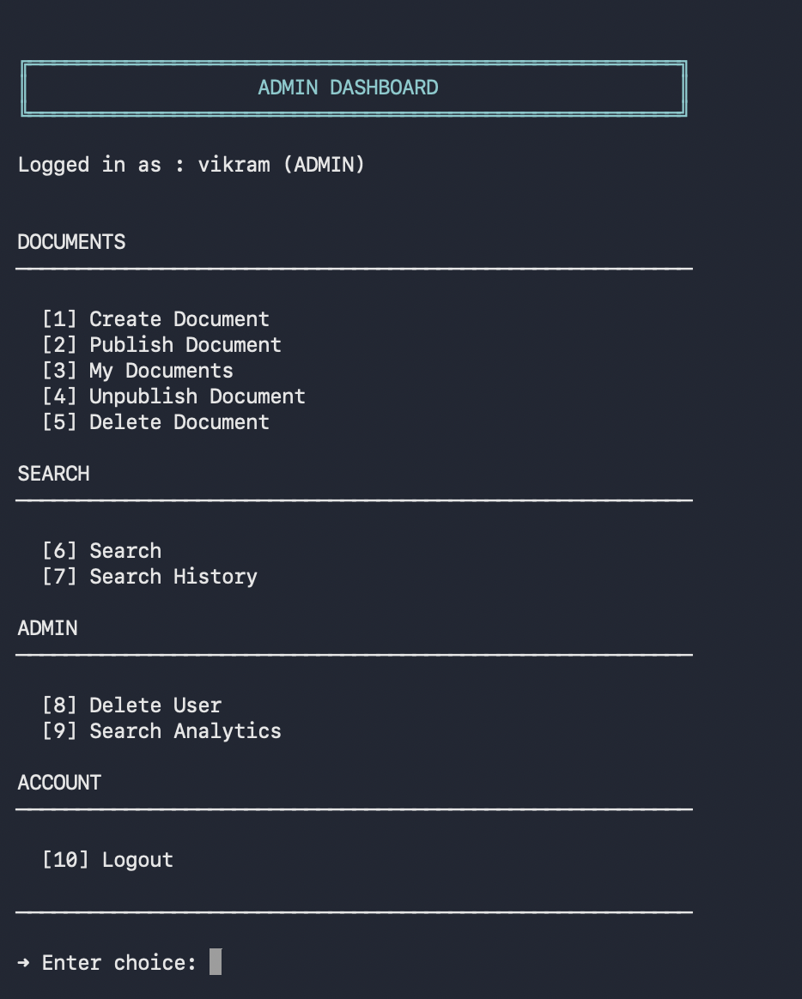
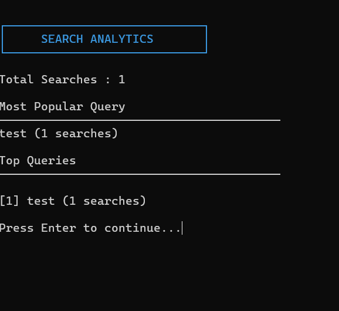
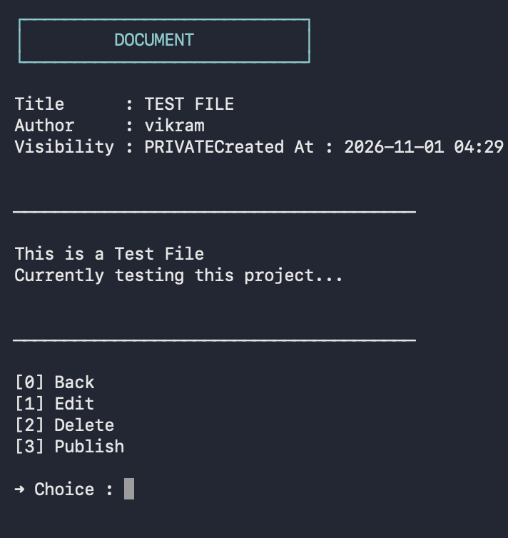
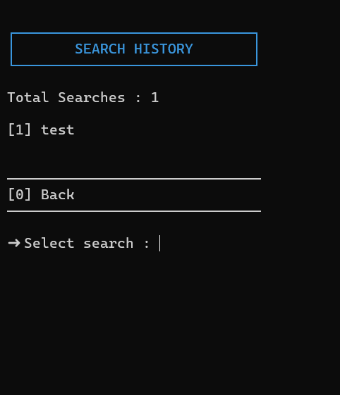
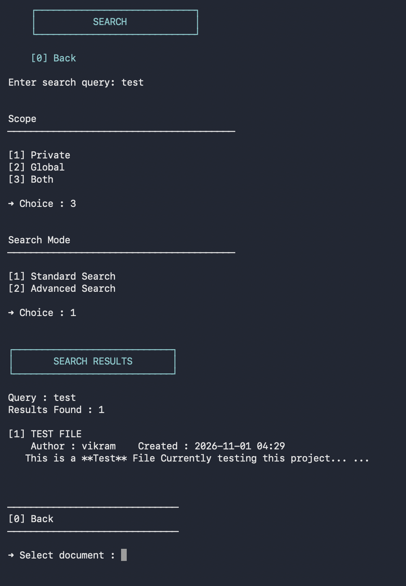
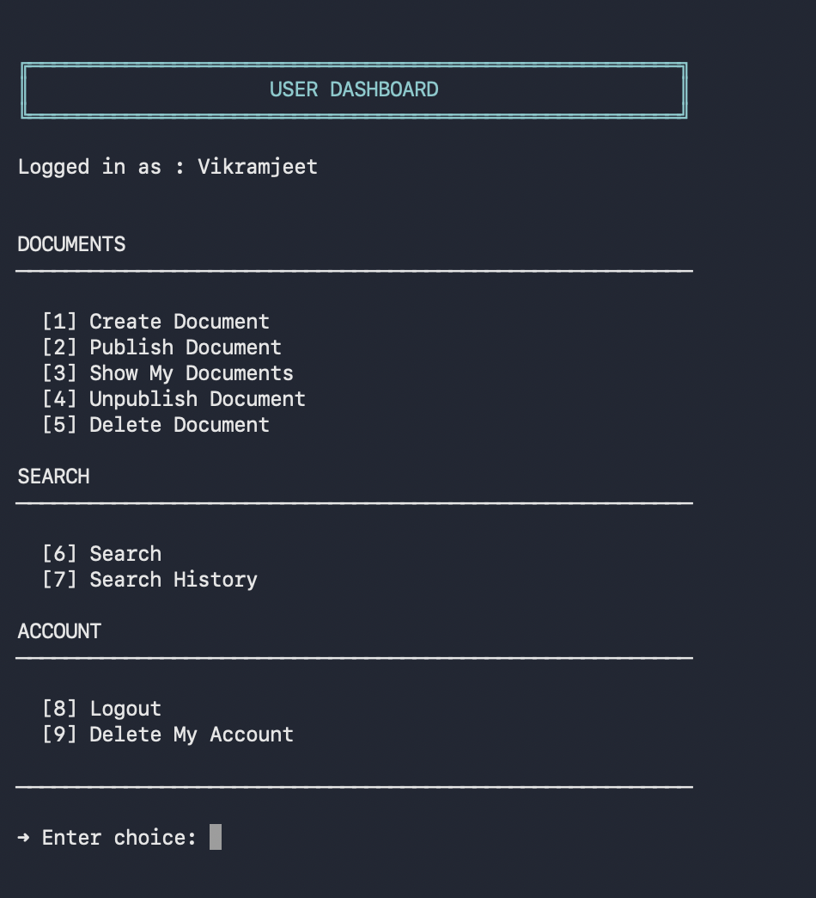

# OOP Document Search System

<p align="center">


</p>

<p>
A C++17 command-line document search application by Vikramjeet Barman. It combines inverted-index and trie-based lookup with filtering, ranking, access control, and file-backed persistence.
</p>

---

# 🚀 Introduction

The **OOP Document Search System** is a modular command-line application for creating, managing, and searching documents. It is built with C++17 and CMake.

The search pipeline combines an inverted index and trie with exact, phrase, prefix, and fuzzy search strategies. Results can be ranked with BM25, popularity, or recency strategies and narrowed with author, date, minimum-length, and visibility filters.

The code is organized into separate modules for the CLI, users, documents, storage, indexing, search, ranking, filtering, and access control. Strategy, Observer, and Chain of Responsibility patterns are used in the search and filtering flows.

This project is maintained by **Vikramjeet Barman**. See the build instructions below to compile and run it locally.

---

# ✨ Project Highlights

- 🔍 Four search algorithms (Exact, Phrase, Prefix, Fuzzy)
- 📈 Three ranking strategies (BM25, Popularity, Recent)
- 🌳 Trie and Inverted Index based document indexing
- ⚡ LRU Cache for repeated query optimization
- 📊 Search Analytics and Search History using the Observer Pattern
- 🛡️ Role-Based Access Control for public and private documents
- 💾 Persistent file storage with automatic loading and saving
- 🧩 Modular architecture built using modern C++17

# 📖 Table of Contents

- [Features](#-key-features)
- [Architecture](#-system-architecture)
- [Build and run](#-getting-started)
- [Project structure](#-project-structure)
- [Screenshots](#-screenshots)
- [GitHub setup](#-publish-to-your-own-github-repository)

---

# 📖 Overview

The **OOP Document Search System** is a modular, command-line document management and retrieval application built using **modern C++**.

Unlike a simple keyword search application, this project implements many of the core components found in real-world search systems, including:

- Efficient document indexing
- Multiple search techniques
- Advanced ranking algorithms
- Query filtering
- Search caching
- Search analytics
- Role-based access control
- Persistent storage

The project was primarily developed to demonstrate strong **Object-Oriented Programming**, **software design**, and **data structure implementation** skills.

---

# ✨ Key Features

## 👤 User Management

- User Registration
- Secure Login
- Role-Based Access Control
- Administrator Accounts
- User Deletion
- Delete Own Account

---

## 📄 Document Management

- Create Documents
- Edit Documents
- Delete Documents
- Publish Documents
- Make Documents Private
- Persistent File Storage
- Document Popularity Tracking
- Creation Timestamp

---

## 🔍 Search Capabilities

Supports multiple search techniques:

- Exact Search
- Phrase Search
- Prefix Search (Trie)
- Fuzzy Search (Levenshtein Distance)

Advanced query support:

- Author Filter
- Date Range Filter
- Minimum Length Filter
- Search Scope
  - Private
  - Global
  - Both

---

## 📊 Ranking

Three ranking strategies are available:

- BM25 Relevance Ranking
- Popularity Ranking
- Most Recent Ranking

The ranking strategy can be selected dynamically during advanced search.

---

## 📈 Analytics

- Search History
- Query Frequency Tracking
- Total Searches
- Most Popular Queries
- Top Query Dashboard

---

## ⚡ Performance Features

- Inverted Index
- Trie Index
- LRU Cache
- Efficient Tokenization
- Stopword Removal
- Query Normalization

---

# 🏗️ System Architecture


---

The application follows a layered architecture where the user interface interacts with a centralized search pipeline that coordinates indexing, filtering, ranking, caching, and persistence.

---

# 💻 Technology Stack

| Category | Technology |
|-----------|------------|
| Language | C++17 |
| Build System | CMake |
| Interface | Command Line Interface |
| Persistence | File Storage |
| Containers | STL |
| Compiler | GCC / Clang / MSVC |

---

# 🧱 Object-Oriented Design

This project demonstrates all four fundamental pillars of Object-Oriented Programming.

## Encapsulation

Application data and behaviour are encapsulated into independent classes such as:

- User
- Document
- SearchPipeline
- Query
- SearchResult
- InvertedIndex
- Trie

Each class exposes only the required public interface while hiding implementation details.

---

## Abstraction

Complex operations such as searching, ranking, filtering, and persistence are abstracted behind dedicated interfaces.

Examples include:

- SearchStrategy
- RankingStrategy
- AccessPolicy
- SearchObserver

This allows components to interact through well-defined interfaces rather than concrete implementations.

---

## Inheritance

The project uses inheritance to build extensible frameworks for:

- Search Strategies
- Ranking Strategies
- Search Observers
- Access Policies

Derived classes implement specialized behaviour while sharing common interfaces.

---

## Runtime Polymorphism

Dynamic dispatch is used extensively throughout the project.

Examples include:

- Runtime selection of ranking strategies
- Runtime selection of search strategies
- Observer notifications
- Access policy evaluation

This enables behaviour to change dynamically without modifying client code.

---

# 🎨 Design Patterns

The project makes use of several well-known software design patterns.

| Pattern | Purpose |
|----------|---------|
| Strategy Pattern | Search algorithms and ranking strategies |
| Observer Pattern | Search history and analytics |
| Chain of Responsibility | Query filtering |
| Repository Pattern | Persistent document storage |
| Dependency Injection | Loose coupling between major components |


Each pattern was selected to improve modularity, extensibility, and maintainability of the system.

---

# 🔍 Search Pipeline

The application processes every search request through a modular search pipeline.



The pipeline is responsible for coordinating every stage of query execution while keeping individual components independent and reusable.

---

# 📂 Core Data Structures

The efficiency of the search system relies on multiple specialized data structures.

---

## Inverted Index

The inverted index maps each normalized token to the documents containing it, along with the frequency of the token in each document.

### Example

```text
"cpp"
   ├── Document 1 (freq = 3)
   ├── Document 4 (freq = 1)
   └── Document 8 (freq = 5)

"search"
   ├── Document 2 (freq = 2)
   ├── Document 3 (freq = 4)
   └── Document 8 (freq = 1)
```

Each posting stores:

- Document ID
- Term Frequency within the document

### Purpose

- Fast keyword lookup
- Efficient BM25 computation using term frequencies
- Reduced search complexity
- Supports Exact, Phrase, and Fuzzy Search

---

## Trie

A Trie is maintained for every indexed token.

```
(root)
  │
  ├── c
  │    └── p
  │         └── p
  │
  ├── d
  │    └── o
  │         └── c
  │
  └── s
       └── e
            └── a
```

### Purpose

- Prefix Search
- Auto-complete style traversal
- Efficient O(length of prefix) lookup

---

## LRU Cache

Previously executed queries are cached.

```
Query
   │
   ▼

Cache Hit
   │
   ▼

Return Results Immediately
```

Benefits

- Avoids repeated ranking
- Reduces repeated indexing work
- Improves repeated search latency

---

## Search History

Every successful search generates a SearchEvent.

The event stores

- Query
- Timestamp
- Search Results

These events are later displayed in the Search History dashboard.

---

## Search Analytics

Search analytics collects statistics such as

- Total searches
- Query frequency
- Most popular queries
- Top searched keywords

This is implemented using the Observer Pattern without coupling analytics to the search pipeline.

---

# 🔎 Search Algorithms

The project combines multiple retrieval algorithms.

---

## Exact Search

Exact Search returns documents containing all normalized query tokens.

Example

```
Query

computer science

↓

Documents containing

computer

AND

science
```

---

## Phrase Search

Phrase Search matches an exact normalized phrase within a document.

### Example

```text
Query

"machine learning"

Matches

"...machine learning is widely used..."

Does NOT Match

"...machine deep learning..."

"...learning machine..."

"...machine intelligent learning..."
```

---

## Prefix Search

Prefix Search is implemented using the Trie.

Example

```
Query

prog

Matches

program
programming
progress
project
```

---

## Fuzzy Search

Fuzzy Search allows minor spelling mistakes.

Implemented using

- Levenshtein Distance

Example

```
Query

algoritm

Matches

algorithm
```

Thresholds are adjusted according to token length.

---

# 📈 Ranking Algorithms

After candidate documents are retrieved, they are ranked.

The ranking strategy is selected dynamically during Advanced Search.

---

## BM25 Ranking

Default ranking strategy.

Ranks documents according to

- Term Frequency
- Inverse Document Frequency
- Document Length

Produces significantly better relevance than simple keyword counting.

---

## Popularity Ranking

Documents are ranked according to popularity.

Popularity increases every time a document is viewed.

Useful for

- Frequently accessed documents
- Trending content

---

## Recent Ranking

Ranks documents by creation timestamp.

Useful when users are interested in the latest content.

---

# 🛠 Advanced Search Filters

Multiple filters may be combined.

Supported filters include

### Author Filter

Restricts results to documents written by a specific user.

---

### Minimum Length Filter

Returns only documents exceeding a specified token count.

---

### Date Range Filter

Filters documents created within a selected time interval.

Available options include

- Last 24 Hours
- Last 7 Days
- Last 30 Days
- Last Year
- All Time
- Custom Range

---

# 📁 Project Structure

```text
src
├── cache         # LRU cache for search results
├── cli           # Command-line interface and menus
├── core          # Core models and shared abstractions
├── documents     # Document management
├── filter        # Query filter implementations
├── index         # Inverted Index and Trie implementations
├── observer      # Search history and analytics
├── ranking       # Ranking strategy implementations
├── search        # Search pipeline and search algorithms
├── security      # Access control and authorization
├── storage       # Persistent file storage
├── user          # User management and authentication
└── util          # Utility functions

resources
└── stopwords.txt

data
├── documents.txt
└── users.txt
```

The project is organized into modular components with clearly defined responsibilities. Core functionalities such as indexing, searching, ranking, caching, persistence, and access control are isolated into dedicated modules, making the system easy to maintain and extend.

---

# Getting Started

## Prerequisites

Ensure the following tools are installed:

- C++17 compatible compiler (GCC / Clang / MSVC)
- CMake (>= 3.10)

Verify installation

```bash
g++ --version
cmake --version
```

---

# ⚙️ Building the Project

From the project root, configure and build with CMake:

```bash
cmake -S . -B build
cmake --build build
```

Run the executable from the project root so the application can find its `data/` files:

```bash
./build/cli
```

On Windows, run `build\Debug\cli.exe` or `build\Release\cli.exe`, depending on the generator configuration.

---

# ▶️ Application Workflow

The following diagram illustrates a typical user interaction with the system.



---

# 📖 User Guide

## Registration

New users can create an account by providing:

- Username
- Password

Each username must be unique.

---

## Authentication

Users can log in using their registered credentials.

The included user and document stores start empty. Registering creates a standard user account; administrator-only features require an administrator record in `data/users.txt`. This application stores passwords and documents in plaintext, so use disposable credentials and non-sensitive content only.

> The tracked data files are intentionally empty in this repository. Any accounts and documents created while running the application are written to these files. Do not commit real credentials or private document content.

Depending on their role, users are redirected to either:

- User Dashboard
- Administrator Dashboard

---

## Document Management

Authenticated users can:

- Create documents
- Edit documents
- Delete documents
- Publish documents
- Make documents private
- View their own documents

Administrators have additional privileges for managing users and monitoring system activity.

---

## Searching

The application supports two search modes.

### Standard Search

Uses:

- BM25 Ranking
- Automatic query normalization

Recommended for everyday searching.

---

### Advanced Search

Supports:

- Ranking strategy selection
- Author filter
- Date range filter
- Minimum length filter
- Search scope selection

Provides fine-grained control over document retrieval.

---

# 📊 Search Analytics Dashboard

The Administrator Dashboard provides system-wide analytics, including:

- Total searches
- Most popular query
- Top searched keywords
- Query frequency statistics

Statistics are automatically maintained using the Observer Pattern.

---

# 📚 Search History

Each user maintains an independent search history.

Every search records:

- Query
- Timestamp
- Matching documents

Users can revisit previous searches without executing them again.

---

# 🔐 Access Control

Documents support two visibility levels.

### Public

Visible to all authenticated users.

---

### Private

Accessible only by the document owner.

Access permissions are enforced through the Access Policy layer before every search request.
---

# 🖥 Example Session

```
=============================
      DOCUMENT SEARCH
=============================

1. Search
2. My Documents
3. Search History
4. Analytics
5. Logout

Choice : 1

Enter Query : algorithm

Search Mode

1. Standard
2. Advanced

Choice : 2

Ranking

1. BM25
2. Popularity
3. Recent

Results

1. Algorithms Notes
2. Introduction to Graph Theory
3. Competitive Programming Guide
```

---
# 📷 Screenshots









# 🎯 Learning Outcomes

This project demonstrates practical implementation of

- Object-Oriented Programming
- Software Design Principles
- Design Patterns
- Efficient Indexing
- Information Retrieval
- Data Structures
- File Persistence

---

# 🤝 Contributing

Contributions, suggestions, and improvements are welcome.

Feel free to open an issue or submit a pull request.

---

# Publish to Your Own GitHub Repository

This project is published in the private `Vikramjeetbarman/OopsDocumentSearchSystem` repository. From this checkout, review `git status` and push updates with:

```bash
git push
```

The repository starts with empty user and document data files. Check those files and screenshots for private content before committing future changes.

---

# Author

**Vikramjeet Barman**

B.Tech Electrical Engineering

NIT Durgapur

---

<p align="center">

⭐ If you found this project interesting, consider giving it a star!

</p>
